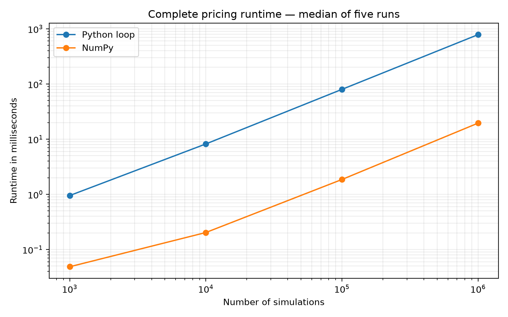
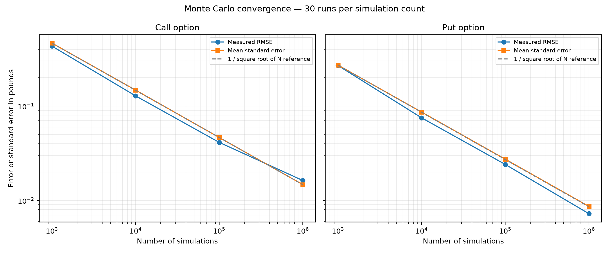
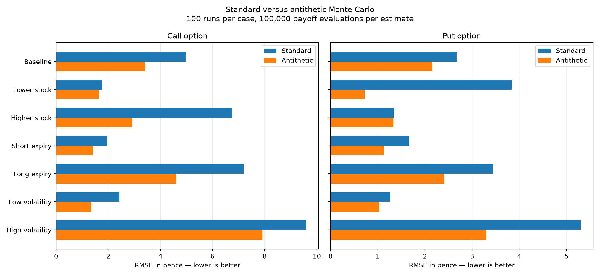

# Monte Carlo Option Pricing

A Python project comparing European option pricing using Black–Scholes, standard Monte Carlo simulation and antithetic variates.

The project investigates how simulation count, implementation and sampling method affect pricing accuracy, uncertainty and runtime.

## Methods

- Black–Scholes analytical pricing for European calls and puts.
- A Python loop implementation of Monte Carlo pricing.
- A vectorised NumPy implementation.
- Antithetic sampling using paired random draws.
- Standard errors and approximate 95% confidence intervals.

All methods use matching assumptions: no dividends, constant volatility, a constant continuously compounded risk-free rate and European exercise.

Monte Carlo uses exact terminal sampling under geometric Brownian motion. Daily price paths are unnecessary for these terminal-payoff options.

## Results

### Runtime

For one million simulations:

| Implementation | Median runtime |
|---|---:|
| Python loop | 782.931 ms |
| NumPy | 19.503 ms |

The NumPy implementation was approximately **40.1 times faster** in this benchmark.

Timings cover the complete pricing functions, including random-number generation and uncertainty calculations. They compare implementations rather than isolating vectorisation alone.

Each measurement is the median of five runs on the same machine. Results depend on hardware and software.



### Convergence

Across 30 independent runs per simulation count, pricing error generally decreased as the number of simulations increased.

At one million simulations:

| Option | RMSE |
|---|---:|
| Call | £0.01627 |
| Put | £0.00725 |

The observed standard errors followed the expected inverse-square-root relationship with simulation count.



### Antithetic sampling

In a baseline comparison using 100 runs and 100,000 payoff evaluations per estimate:

| Option | Standard RMSE | Antithetic RMSE | RMSE reduction |
|---|---:|---:|---:|
| Call | £0.05107 | £0.03562 | 30.3% |
| Put | £0.02753 | £0.02228 | 19.1% |

A separate experiment varied stock price, expiry and volatility across seven scenarios for calls and puts. Observed RMSE reductions ranged from approximately **0.9% to 80.9%**.

The benefit varied substantially by scenario. Small measured improvements should not be treated as conclusive.

Both methods used equal numbers of payoff evaluations. For antithetic sampling, 100,000 evaluations correspond to 50,000 independent pair averages. Standard errors are calculated from those pair averages.



## Setup

Developed with Python 3.13.17 and NumPy 2.5.4 on Windows 11.

From the project folder, create an environment and install dependencies:

```powershell
py -3.13 -m venv .venv
.\.venv\Scripts\python.exe -m pip install -r requirements.txt
```

## Run the pricing models

```powershell
.\.venv\Scripts\python.exe black_scholes.py
.\.venv\Scripts\python.exe monte_carlo.py
.\.venv\Scripts\python.exe monte_carlo_numpy.py
.\.venv\Scripts\python.exe monte_carlo_antithetic.py
```

## Run the checks

```powershell
.\.venv\Scripts\python.exe payoffs.py
.\.venv\Scripts\python.exe test_black_scholes.py
.\.venv\Scripts\python.exe test_monte_carlo.py
.\.venv\Scripts\python.exe test_monte_carlo_numpy.py
.\.venv\Scripts\python.exe test_monte_carlo_antithetic.py
```

Checks include benchmark prices, expiry and zero-volatility behaviour, put–call parity, reproducibility, controlled payoff examples and agreement between loop and NumPy calculations using identical random draws.

## Reproduce the experiments

Run from the project folder:

```powershell
.\.venv\Scripts\python.exe benchmark.py
.\.venv\Scripts\python.exe convergence.py
.\.venv\Scripts\python.exe compare_methods.py
.\.venv\Scripts\python.exe scenario_comparison.py
.\.venv\Scripts\python.exe plot_results.py
.\.venv\Scripts\python.exe plot_scenarios.py
```

These commands regenerate the CSV results and figures. Timings will vary between runs.

## Limitations

- Prices are theoretical model values, not market-price predictions.
- Inputs are controlled scenarios rather than calibrated market data.
- Confidence intervals describe Monte Carlo sampling uncertainty, not model error.
- Coverage and RMSE estimates fluctuate across finite experiments.
- The scenario study changes one input at a time; it does not cover every combination.
- Black–Scholes already provides an analytical solution for these options. It serves as a benchmark for validating the simulation methods.